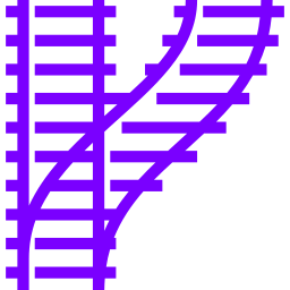

= inanepain/routing 
// tag::tagConfig[]
:author: Philip Michael Raab
:email: <philip@cathedral.co.za>
:description: HTTP Routing using attributes.
:keywords: routing, router, route, attribute
:homepage: https://github.com/inanepain/routing
:revnumber: 1.5.0
:revdate: 2026-10-13
:copyright: Unlicense
:experimental:
:hide-uri-scheme:
:icons: font
:source-highlighter: highlight.js
:toc: auto
:sectanchors:
:idprefix: topic-
:idseparator: -
:pkg-vendor: inanepain
:pkg-name: routing
:pkg-id: {pkg-vendor}/{pkg-name}
// end::tagConfig[]

==  {pkg-id}

NOTE: documentation updated for *1.5.0*: the `Route` attribute, `Router`, `RouteMatch` and the new `AttributeRouteCollector` each have their own section.

{description}

Add routing to your application by simply using attributes on your methods to configure the route.

In short: mark the controller methods you want reachable with the `Route` attribute, hand the controllers to the `Router` and ask it for a match.

:sectnums:

<<<

include::./part/install.adoc[leveloffset=+1]

<<<

include::./part/attributes.adoc[leveloffset=+1]

<<<

include::./part/router.adoc[leveloffset=+1]

<<<

include::./part/routematch.adoc[leveloffset=+1]

<<<

include::./part/collector.adoc[leveloffset=+1]

<<<

include::./part/usage.adoc[leveloffset=+1]

<<<

include::./part/appendix.adoc[leveloffset=+1]
